# MyInfra

**Your own application platform, on servers you rent.** Open source, self-hosted, Apache-2.0.

MyInfra puts an application online without asking you to know Docker or Kubernetes. You pick an application, a name, and a place to run it: a machine you already have, or a cluster of machines bought from your cloud provider. MyInfra handles the domain name, the HTTPS certificate, the proxy, the redundancy, and keeping the application running. The screen talks about applications, servers, and addresses — not namespaces, ingresses, or ports.

It is one program you run yourself, on your laptop or on a server. There is no account to create, no subscription, and no hosted service: the code you read is the code you run. **It is free**, under the Apache-2.0 license; you only pay your provider for the servers you choose.

[](LICENSE)
[](https://github.com/tainalo2/MyInfra/releases)
[](https://github.com/tainalo2/MyInfra/actions/workflows/ci.yml)

Project page: **https://tainalo2.github.io/MyInfra/** — in English, French, German, Italian and Portuguese (for example [`?lang=fr`](https://tainalo2.github.io/MyInfra/?lang=fr)).

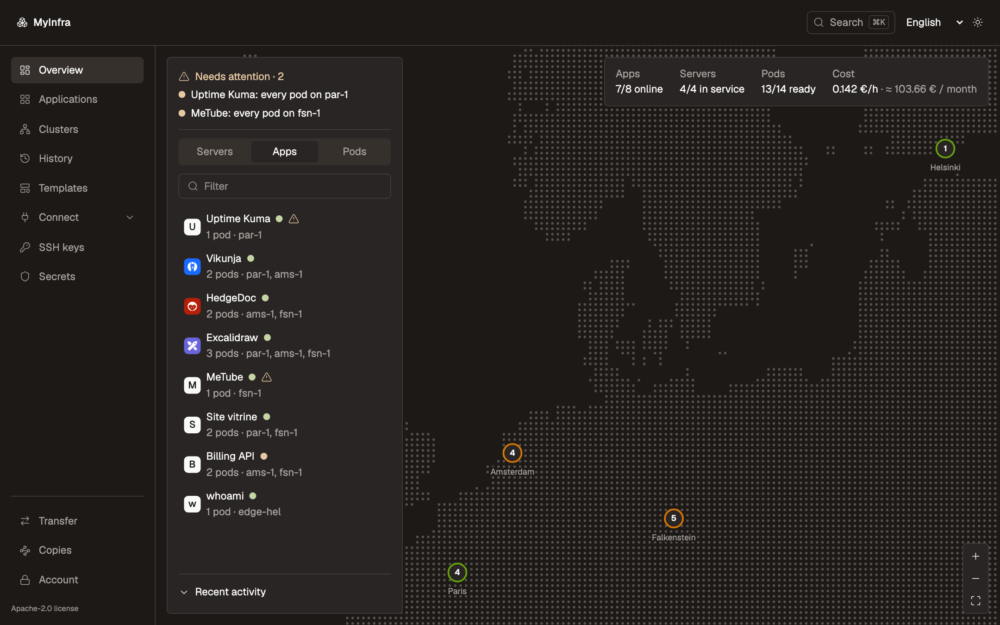

## Contents

- [Screenshots](#screenshots)
- [Features](#features)
- [Quick start](#quick-start)
- [Technologies](#technologies)
- [Architecture](#architecture)
- [Build it yourself](#build-it-yourself)
- [How it works](#how-it-works)
- [Updates](#updates)
- [Validated integrations](#validated-integrations)
- [Transparency](#transparency)

## Screenshots

The screenshots show demo data (invented names, `example.com` domains, documentation addresses) in the dark theme. The interface also has a light theme and five languages: English, French, German, Italian and Portuguese.

| | |
| --- | --- |
| 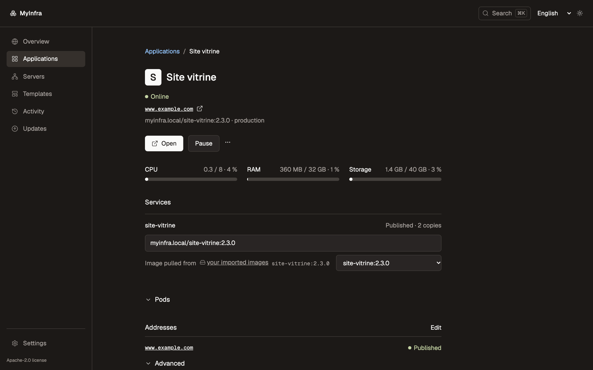 | 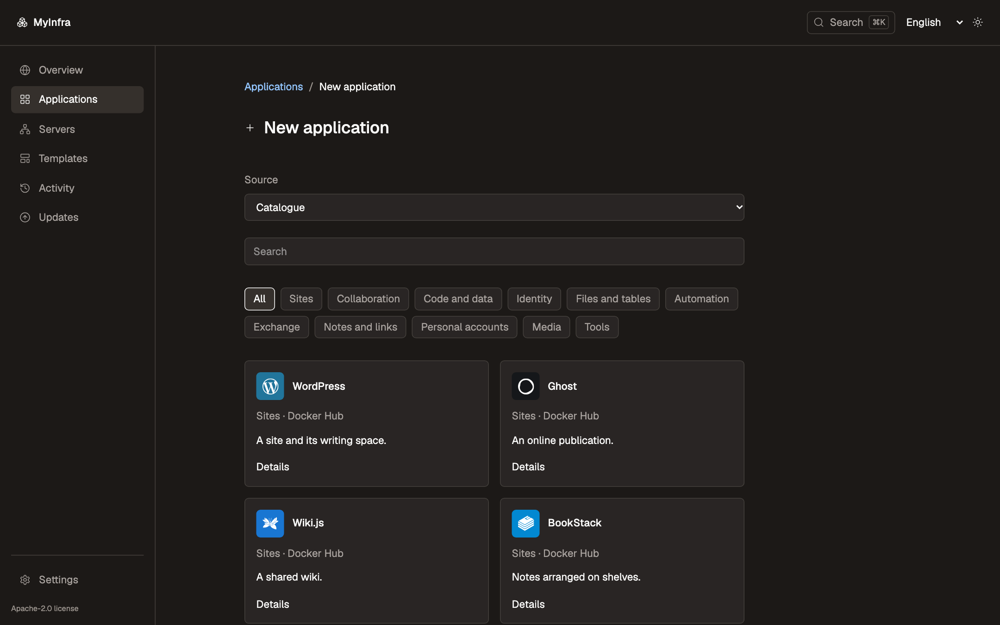 |
| **An application**: status, address, resources, where its image comes from, its pods and addresses. | **The library**: ready-made applications, each with the registry its image comes from. |
| 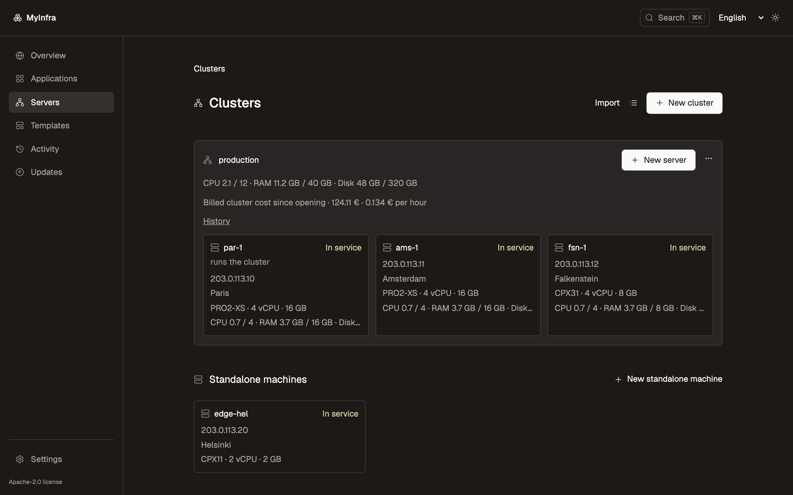 | 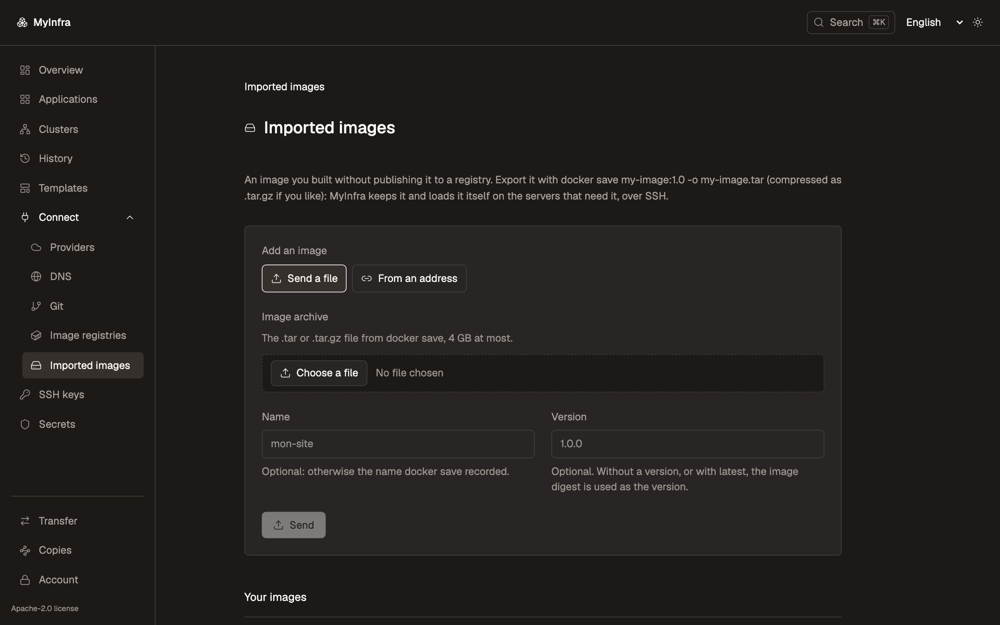 |
| **Clusters and machines**: nodes across providers and places, usage and billed cost. | **Imported images**: bring your own image as a `docker save` archive, sent or fetched from a URL. |
| 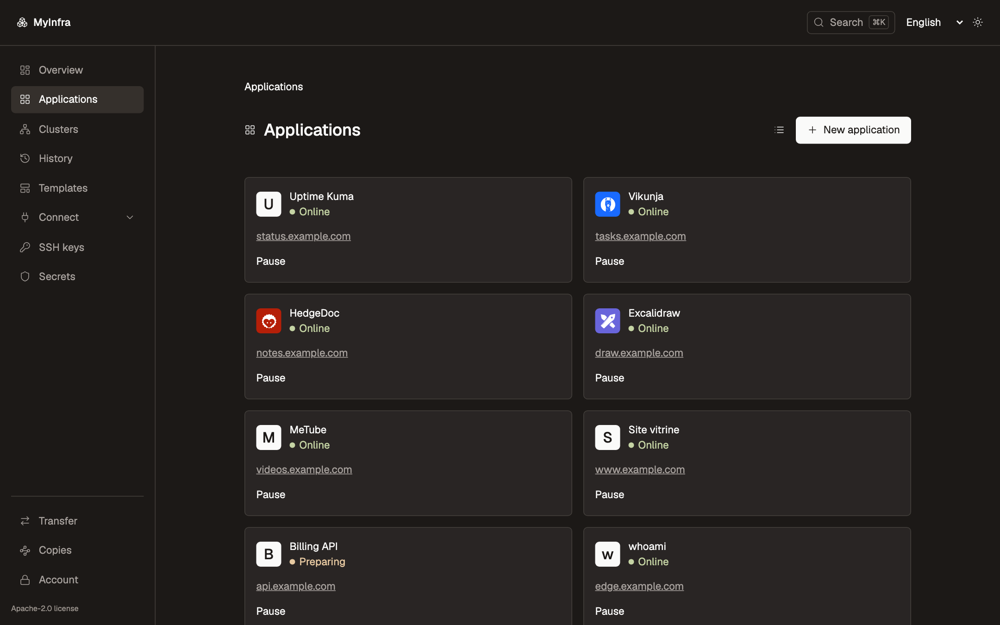 | 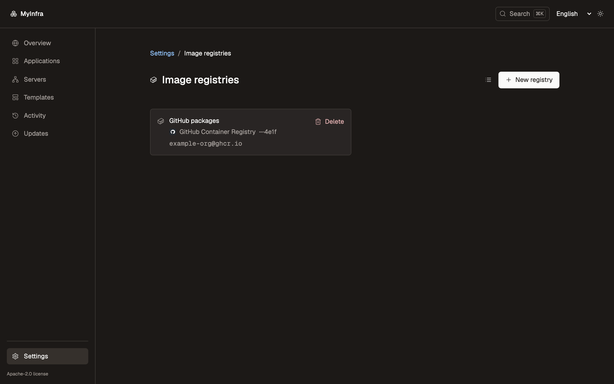 |
| **Applications**: every application and its state at a glance. | **Image registries**: logins for private registries, checked before they are saved. |
| 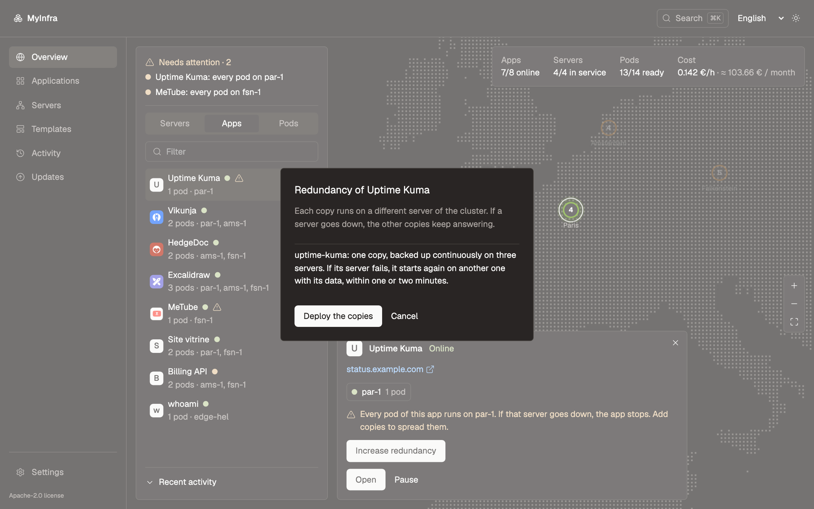 | 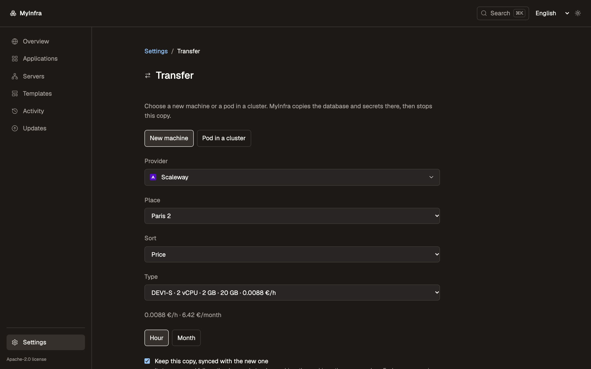 |
| **Automatic redundancy**: copies on different servers, continuous backups, replicated databases — one button. | **Start locally, continue online**: move MyInfra itself to a server or into your cluster. |
| 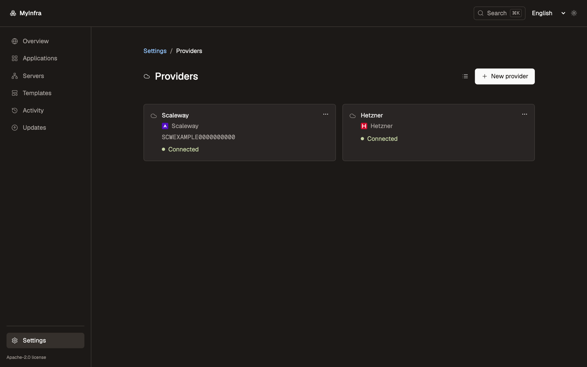 | 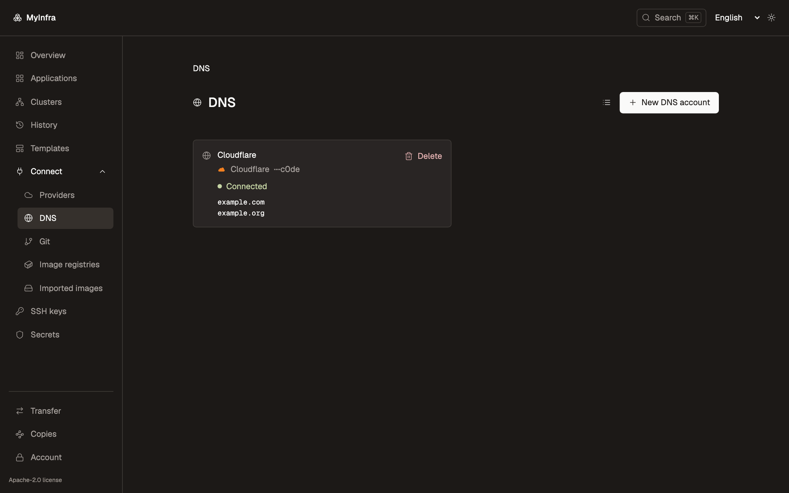 |
| **Providers**: your own accounts at Scaleway, Hetzner, OVHcloud and nine more. | **DNS**: records written and removed for every address. |
| 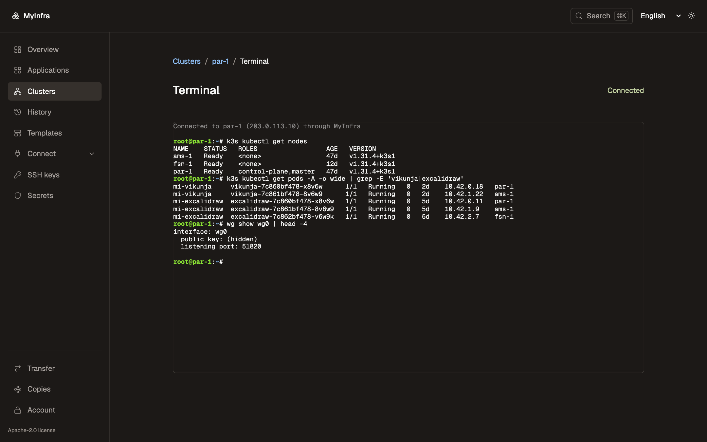 | 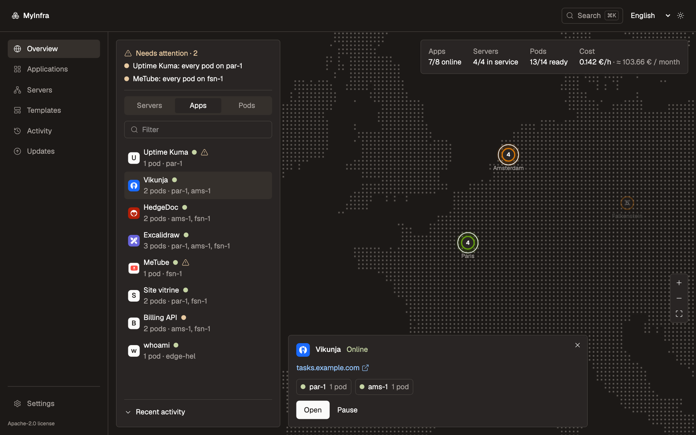 |
| **Terminal**: a shell on any server or inside any pod, in the browser. | **Overview**: pick an application to see the servers that run it. |

On a phone, the same application, laid out for the thumb:

<p>
  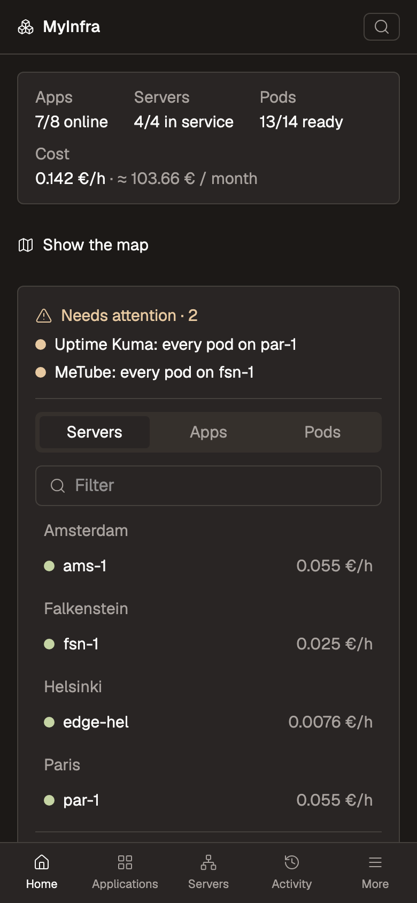
  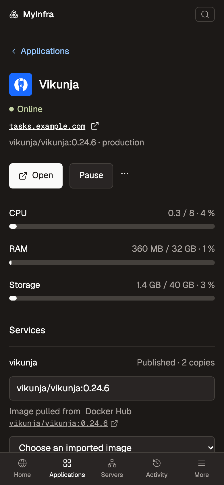
</p>

## Features

**Run applications**

- **Library.** Ready-made applications (sites, wikis, monitoring, notes, media…) and templates that group them with their cluster. Pick one, or start from any image. Each one says which registry its image is pulled from. The library is published apart from MyInfra, in [its own repository](https://github.com/tainalo2/MyInfra-templates-and-packages-library), as signed releases: MyInfra fetches the newest every 6 hours and keeps one built in for offline use. Each package and template has its own version, and a copy you took is offered the next one on the updates page.
- **One machine or a cluster.** The same form. On a machine, the application is a Docker container. On a cluster, it becomes Kubernetes pods.
- **Your own images.** Use any public image, add a private registry (Docker Hub, GitHub Container Registry, GitLab, Quay, or your own), or import an image you built: the `docker save` archive, sent from the browser or fetched from a raw URL. MyInfra loads it on the servers itself over SSH, so they never need to reach MyInfra or a registry. Building an image from a Git repository is not available yet.
- **Domains and certificates.** MyInfra writes the DNS record when a DNS account is linked, then gets the Let's Encrypt certificate. Addresses can be added and removed while the application runs.
- **Multi-service packages.** A package may publish several services, each on its own domain, and share a disk between services (a download client and a media library, for example), held on a node you choose.
- **Redundancy.** When every pod of an application runs on one server, a button spreads it. A stateless application runs several copies on different servers. A SQLite application such as Uptime Kuma keeps one copy whose database is backed up continuously and restarts elsewhere with its data. An application that can use PostgreSQL, such as Vikunja, moves to a database replicated on two servers.
- **Pause.** The pods stop; the disk and the data stay. Visitors see a page saying the service is paused.
- **Logs, terminal, meters.** Pod status and logs, a terminal on the machine or in the pod, CPU, memory and disk use.
- **Online means online.** An application is shown online only once its pods are ready and its address answers in HTTPS with a valid certificate. A server that stops answering, or that its provider no longer has, shows as unreachable or gone, and so do the applications on it; a gone server is removed from MyInfra in one step.

**Run servers**

- **Providers.** Buy and destroy machines at Hetzner, Scaleway, OVH, DigitalOcean, Infomaniak, UpCloud, Akamai, Vultr, Exoscale, Gcore, Kamatera and IONOS, with your own API token. MyInfra does not resell compute.
- **Bring your own machine.** Any Linux machine you already have joins with one command to paste. The command installs MyInfra's SSH key and announces the machine's own address; MyInfra then installs Docker, or Kubernetes on a cluster node, over SSH, as it does for a machine it bought. Choose a city so the machine shows on the map. When MyInfra itself is on the same local network, that command uses the address of your computer instead of localhost.
- **Clusters.** Linked machines running k3s, Traefik at the edge, Kubernetes traffic between nodes over WireGuard only, an odd number of control planes, a name pointing at every node.
- **Raw ports.** A VPN, a remote desktop relay or a game server opens its own TCP or UDP ports on the machines' address (`expose` in a package), besides the domain on 80 and 443. MyInfra keeps the ports it uses itself (SSH, Kubernetes, the cluster's WireGuard) and gives each port to one application.
- **Overview.** A map of every server; switch to applications or pods. Pick an application to light up the servers that run it. A machine you added yourself takes the city you chose. A panel lists what needs attention, and the hourly and monthly cost is always at the top.
- **Templates.** Describe applications, machines and a cluster once; deploy, export or share it. Nine ready-made templates — first steps, website, team workspace, knowledge base, development, monitoring, automation, paperwork, media — only ask for your provider, offers, keys and domain; the applications' passwords are drawn at deployment.

**Keep control**

- **Accounts.** Several people share one installation, with a login and a role. Administration can do everything. Deployment runs servers and applications, can look at connections, and cannot add or remove them, download an SSH private key, or start a transfer. Read-only can look, not change, and has no terminal.
- **Two-factor authentication.** Each account can require a TOTP code, from the same authenticator apps used anywhere else. Signing in then asks for that code after the password. A transfer carries the logins, the roles, the passwords and these codes, so the copy you move keeps the same accounts.
- **Vault.** Provider, DNS and registry tokens, SSH private keys and application secrets are sealed with AES-GCM before they are stored. A list never returns a secret in clear text.
- **Secrets for applications.** Declare keys, then choose the applications allowed to receive them.
- **Copies.** Several MyInfra instances of the same owner keep their databases in sync; a replica does not drive the machines, but takes the lead when the main copy fails — or to act from your laptop — and gives it back afterwards.
- **Work in progress.** A copy on your computer asks you not to switch it off while it works on machines, with a red mark in the header until it is done. During a transfer or an update, changes that could break it wait; removing stays possible.
- **DNS records.** Every record of your zones next to what MyInfra expects, to republish a name or remove one left behind.
- **Transfer.** Move MyInfra itself to a new machine or into a pod of the cluster, and follow the steps.
- **Careful destruction.** Deleting an application, a machine or a cluster asks you to type its name again.
- **AI assistants (MCP).** Claude, Cursor, VS Code or any MCP client drives MyInfra in plain words with a personal access token and its role: find and buy machines within a budget and a region, install applications, change DNS. Purchases, deletions and DNS changes that touch existing records show a recap and wait for your agreement; each action is in the history. See [docs/mcp.md](docs/mcp.md).
- **Mobile.** Bottom tabs, step-by-step forms, a full-screen terminal with an Esc/Tab/Ctrl key bar.
- **One file.** One executable contains the interface and its PostgreSQL, for Linux, macOS and Windows.

## Quick start

### The app

Download the file for your system from the [latest release](https://github.com/tainalo2/MyInfra/releases/latest). The app shows MyInfra in its own window, with no address bar; links to other sites open in your browser. Its log is `myinfra.log` in `~/.myinfra`.

- **macOS**: open `MyInfra_*_macos.dmg` and drag MyInfra into Applications, then open it. Closing the window leaves MyInfra running: its icon stays in the Dock, a click opens the window again, Quit stops it. The app is not signed by Apple: on the first start, allow it in System Settings → Privacy & Security → Open Anyway.
- **Windows**: run `MyInfra_*_windows_amd64_setup.exe`. It installs MyInfra for your account, without administrator rights, and adds it to the Start menu. Closing the window stops MyInfra. The window uses WebView2, shipped with Windows 10 and 11. The setup is not signed: if SmartScreen stops it, choose More info, then Run anyway.
- **Linux**: install `myinfra_*_linux_amd64.deb` (Debian, Ubuntu) or `.rpm` (Fedora, openSUSE), then open MyInfra from the applications menu. Closing the window stops MyInfra. The window uses WebKitGTK 4.1, installed with the package. The `.AppImage` needs no installation: make it executable and open it. A `.deb` or `.rpm` is updated by your system; the AppImage updates itself.

Without the web engine of the system, the app opens MyInfra in the browser instead.

### The executable

On a server, or from a terminal, the executable alone is enough:

```sh
chmod +x myinfra_*_linux_amd64
./myinfra_*_linux_amd64
```

On Windows, double-click `myinfra_*_windows_amd64.exe`. A window shows the log; closing it stops MyInfra.

The executable prints its address, for example `http://127.0.0.1:8080`, and opens it. On the first start it creates `~/.myinfra`, writes a master key there, and starts the PostgreSQL it carries. Choose a password, then follow the guided start: an SSH key, a provider token, a DNS account. Each step can be skipped. Further accounts, each with a role and an optional TOTP code, share the same servers and applications.

### Docker Compose

Each release ships a `compose.yaml` that starts PostgreSQL and MyInfra with the image of that version:

```sh
export POSTGRES_PASSWORD=$(openssl rand -hex 16)
export MYINFRA_MASTER_KEY=$(head -c 32 /dev/urandom | base64)   # keep it: it opens your secrets
export MYINFRA_PUBLIC_URL=https://myinfra.example.com
docker compose up -d
```

The image is `ghcr.io/tainalo2/myinfra`, for `linux/amd64` and `linux/arm64`.

### Settings

| Variable | Meaning |
| --- | --- |
| `DATABASE_URL` | Use an external PostgreSQL instead of the embedded one. Then `MYINFRA_MASTER_KEY` is required. |
| `MYINFRA_MASTER_KEY` | 32 random bytes, base64. Seals every secret. Never stored in the database. |
| `MYINFRA_ADDR` | Listen address, `:8080` by default. |
| `MYINFRA_PUBLIC_URL` | The address machines and browsers use to reach MyInfra. |
| `MYINFRA_ACME_EMAIL` | The Let's Encrypt account address. |
| `MYINFRA_NO_BROWSER=1` | Do not open the browser at startup. |
| `MYINFRA_UPDATE_CHECK=0` | Do not ask GitHub for new releases of MyInfra. |
| `MYINFRA_IMAGE` | For a copy built from source: the published image a transfer starts, such as `ghcr.io/tainalo2/myinfra:0.1.0-rc.4`. A release carries its own. |

## Technologies

| Layer | Technology | What it does in MyInfra |
| --- | --- | --- |
| Control plane | **Go 1.24**, standard library HTTP server | The single program: API, deliveries, provider calls, SSH sessions. |
| State | **PostgreSQL 16**, **pgx v5** | Applications, servers, secrets (sealed), events, imported images. An embedded PostgreSQL is unpacked on first start when `DATABASE_URL` is not set. |
| Encryption | **AES-256-GCM**, one data key per secret wrapped by the master key | The vault for tokens, private keys, variables and registry logins. |
| SSH | **golang.org/x/crypto/ssh**, **ed25519** keys | Every action on a machine: running the agent, applying manifests, streaming images. |
| Interface | **React 19**, **TypeScript 5**, **React Router 7**, **Vite 6** | The web interface, embedded in the executable. |
| Design | **Tailwind CSS 4**, **Geist** fonts, **Lucide** icons, **Simple Icons** | Light and dark themes, phone and desktop layouts. |
| Terminal | **xterm.js 6**, WebSocket (**coder/websocket**) | The terminal on a machine or in a pod. |
| Machine alone | **Docker Engine**, **Traefik** | Containers, routing and certificates on a single server. |
| Cluster | **k3s**, **Traefik**, **WireGuard** | Kubernetes, the edge proxy, and an encrypted network between nodes. |
| Installation | **Ansible**, **cloud-init**, optional **OpenTofu** | Installing WireGuard and k3s on a new node; describing Hetzner and Scaleway machines and DNS records. |
| Certificates | **Let's Encrypt** (TLS-ALPN challenge via Traefik) | HTTPS for every address, kept by MyInfra across Traefik restarts. |
| Cluster storage | **Garage** (S3 object store) | Three copies of each object on three servers, for backups and files. |
| Databases | **Litestream**, **CloudNativePG** | Continuous SQLite backups; replicated PostgreSQL for applications that support it. |
| Images | **OCI** and **Docker** registries, `docker save` archives | Public images, private registries with logins, and images imported into MyInfra. |
| Providers | Hetzner, Scaleway, OVH, DigitalOcean, Infomaniak, UpCloud, Akamai, Vultr, Exoscale, Gcore, Kamatera, IONOS APIs | Buying, listing and destroying machines. |
| DNS | OVH, Cloudflare, Scaleway, Hetzner DNS APIs | Writing and removing the records of each address. |
| Packaging | One static binary; a Debian image for `linux/amd64` and `linux/arm64` with Ansible, Python, the SSH client and OpenTofu | The release artifacts. |
| Quality | `go test`, **Playwright** browser tests, **GitHub Actions** | Checks on every push; releases built and published by CI. |

## Architecture

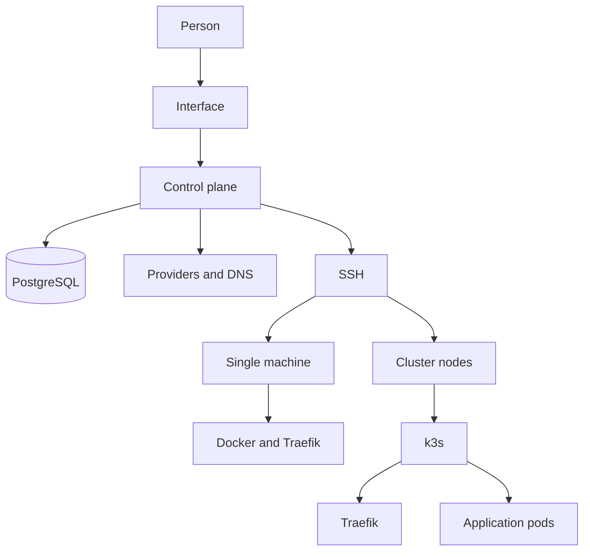

The control plane is the only program you start. The interface is inside it. PostgreSQL keeps the state. The machines do not keep MyInfra's database: they run the applications, and they never need to reach MyInfra — every action goes out over SSH.

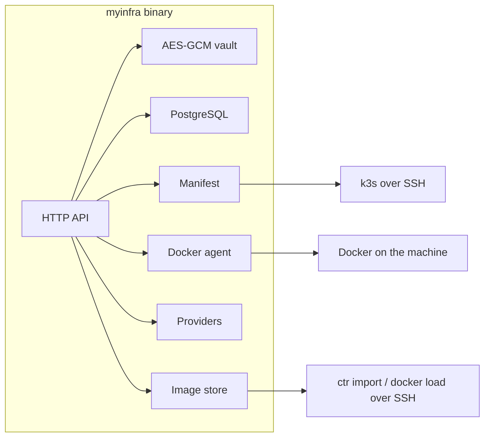

## Build it yourself

### Requirements

- **Go 1.24** or newer
- **Node.js 24** and **npm**
- **unzip** (to pack PostgreSQL into the executable)
- For development only: a local **PostgreSQL 16** (`initdb`, `pg_ctl`), which `./dev` uses
- Optional: **Docker** to build the image

### Get the code

```sh
git clone https://github.com/tainalo2/MyInfra.git
cd MyInfra
```

### Run in development

```sh
./dev            # or npm run dev; on Windows: dev.cmd / dev.ps1
```

`./dev` starts a PostgreSQL cluster in `.pgdata` (port 54329) when `DATABASE_URL` points at this machine, then the Go API on `:8080` and the Vite interface on `:5173` with hot reload. One terminal is enough; stopping it keeps `.pgdata`. `./dev reset` asks for confirmation, saves `~/.myinfra/dev.sql`, then deletes `.pgdata`; `./dev restore` loads that file back. With `MYINFRA_PEERS` naming a main copy, the development copy runs as a replica so the two never drive the same machines.

### Build the executable

```sh
./build                  # this system, into dist/
./build linux arm64      # one target
./build all              # Linux, macOS and Windows, amd64 and arm64
```

`./build` builds the interface, embeds it, downloads the PostgreSQL binaries for the target and packs them in, then compiles a static Go binary into `dist/`. `VERSION` and `IMAGE` set what the executable reports (`myinfra --version`). On Windows, use `build.cmd` or `build.ps1`. Windows arm64 has no embedded PostgreSQL and needs `DATABASE_URL`.

### Build the Docker image

```sh
docker build -t myinfra --build-arg VERSION=dev .
docker run -p 8080:8080 -e DATABASE_URL=… -e MYINFRA_MASTER_KEY=… myinfra
```

The image holds the binary on a Debian base with every tool MyInfra drives — Ansible and its Python, the SSH client, OpenTofu — so that a copy moved to a server installs machines on its own; it uses an external PostgreSQL (see `deploy/compose.yaml`).

### Test

```sh
go vet ./... && go test ./...                         # uses the dev PostgreSQL on port 54329 when needed
cd web && npx tsc --noEmit -p . && npm run build      # type-check and build the interface
E2E_URL=http://127.0.0.1:8080 npm run e2e             # browser tests against a MyInfra started empty
```

### Site screenshots

PNG files under `docs/screenshots/` feed the GitHub Pages site. CI checks that every expected file exists and is large enough (`cd web && npm run screenshots:check`). To regenerate them locally, start an empty MyInfra on `:8080`, then:

```sh
cd web && E2E_URL=http://127.0.0.1:8080 npm run screenshots
```

### Multi-copy sync

Copies sharing the same master key exchange applications, destructions, template runs, and update state. The **peer list** in the UI is local to each copy: set `MYINFRA_PEERS` to the same comma-separated URLs on every copy at startup; each successful sync also adds the remote copy as a peer. Only one copy drives SSH and deployments at a time; a running destruction resumes on the copy that **takes the lead**. See [docs/CLUSTER_UPGRADE.md](docs/CLUSTER_UPGRADE.md) for a deployment checklist.

### Roadmap and backups

Short roadmap: [docs/ROADMAP.md](docs/ROADMAP.md). Optional **off-site S3** replicas for SQLite apps: [docs/BACKUPS.md](docs/BACKUPS.md) (`MYINFRA_OFFSITE_S3_*`).

### Release

Push a tag such as `v1.4.0`, or run the **Publication** workflow from the Actions tab with a version. It checks the code, builds the `./build` executables for the six targets (each one is checked, and the Linux one is started with its embedded PostgreSQL), builds the multi-architecture image on `ghcr.io`, and publishes a GitHub release with the executables, a `compose.yaml` pinned to that image, and `SHA256SUMS`. A version with a suffix such as `1.4.0-rc.1` is a pre-release and leaves the `latest` image alone.

## How it works

**Startup.** With no variables, the binary creates `~/.myinfra`, writes a master key there, and starts the PostgreSQL it carries. The data stays when the process stops. Then you choose a password for the first account. Further accounts share that installation: each has a login, a role (administration, deployment or read-only) and, if you turn it on, a TOTP code checked at sign-in. On the pages that install a machine, a button installs Ansible into `~/.myinfra` when it is missing — with its own Python when the machine has none, and OpenTofu for Hetzner and Scaleway when `MYINFRA_TOFU_DIR` is set. Neither needs an administrator password.

**Create an application.** The library fills in the image, the port, the disk and the variables. For any other image, MyInfra reads the port and the folders to keep that the image declares (`EXPOSE`, `VOLUME`). The control plane stores the application, then delivers it.

**Delivery on a cluster.** MyInfra renders a manifest — namespace, Deployment or StatefulSet, Service, Traefik routes, a Secret for the variables, and a pull secret when the image comes from a private registry — and applies it over SSH. An unreadable image, name or variable is not applied, and the application in place is not removed. The first SSH key of a node is remembered; a different key is refused.

**Delivery on a machine.** MyInfra runs the agent script on the machine over SSH. The script creates the Docker network, the volume if the application keeps files, and the container; Traefik sends the domain name to that container.

**Raw ports.** A port a service exposes is published on the machine by Docker (`-p`), or on every node of a cluster by a `LoadBalancer` Service that k3s's ServiceLB serves; the firewall lets it in. Such a service is replaced in place, since only one container can hold the port, and runs one copy on a machine alone.

**Imported images.** An archive from `docker save` (Docker or OCI layout, compressed or not, up to 4 GB) is read, renamed `myinfra.local/<name>:<version>` and stored in PostgreSQL. Before a delivery, MyInfra streams it over SSH to every server that needs it (`ctr images import` on a cluster node, `docker load` on a machine) and checks again every ten minutes that it is still there.

**Addresses.** A new address waits for its DNS record, then the next delivery gives it a route and Traefik a certificate. A removed address loses its record, then its route. Whether an address answers is checked against the zone's own name servers, so a resolver cache cannot keep an application waiting.

**Machines.** A cluster node first joins the WireGuard network at an address that never changes, then installs k3s with that address. Removing a node moves its pods to the others before the machine is destroyed. A deployment cut off by a restart starts again where it stopped; a purchase cut off finds its machine again instead of buying a second one.

**Redundancy.** With at least three linked servers, MyInfra installs Garage on the cluster: each object lives on three servers. A SQLite application gets Litestream next to it and restores its database when it starts, so Kubernetes can start it on any node 30 seconds after its node stopped answering. An application moving to PostgreSQL is stopped, its data dumped and restored into a CloudNativePG cluster of two instances, then checked before it runs several copies; if anything fails, it goes back to its disk, which MyInfra never removes. Traefik gets its certificates back when it moves, so moving asks Let's Encrypt for nothing.

**Secrets.** Values are sealed before they are written and never returned by the API. At delivery time, MyInfra opens them and attaches them to the allowed application; if opening fails, the application is not redeployed without its secrets.

**Copies.** Two MyInfra instances of the same owner exchange database rows; the newer version wins. Sessions and imported images do not travel. A replica deploys nothing. Taking the lead raises a term shared by the copies: the main copy, when it answers, gets the last changes and steps aside; when it does not, it steps aside by itself once it is back and meets the later term during the sync. With two pods on one database, a PostgreSQL lock lets only one of them drive.

**Reachability.** Every minute, MyInfra knocks on the SSH port of each server (without logging in) and calls the address of each application. Three misses in a row make it unreachable. Soon after, and every six hours otherwise, the provider is asked whether the machine still exists; only a clear "not found" marks it gone.

**Transfer.** MyInfra can move itself: to a machine with cloud-init, or into the cluster as two pods with Postgres, under a name you choose in your zone. The data is copied, including the accounts: logins, roles, passwords and two-factor secrets. Then the old copy either stops, or stays as a synced copy that no longer drives the machines — handy to keep MyInfra on a laptop. Each copy lists the other when it can reach it. In the cluster, MyInfra shows as an application that cannot be removed or changed.

## Updates

MyInfra looks for updates by itself — applications every six hours, servers every twelve, MyInfra every six — and applies none of them on its own. The **Updates** page, a badge on each application, server and cluster, and a line in *Needs attention* show what is waiting; a security fix or a pending restart shows in red. Before anything starts, a dialog lists every application with what the update does to it: no interruption, about thirty seconds while one copy starts elsewhere, or stopped until its server is back.

**Applications.** A newer version of the same flavour (`2.2.6` → `2.2.7`, never `-alpine` to `-debian`) comes from the registry, with the logins of private registries. A tag that does not change, such as `postgres:16` or `latest`, is compared by digest: a new build is offered, and once applied the image is pinned to that digest so that every node pulls exactly it. On a cluster, a new copy must accept connections before an old one stops (`maxUnavailable: 0`, a TCP readiness probe), and a copy that keeps its files on a node disk is replaced in place. On a machine, the new container must keep running and answer on its port before the old one is removed. If the new version does not start within a few minutes, the previous image — or the previous variables, which can now be changed on a running application — comes back by itself. A major version asks you to confirm that you read its notes.

**Servers.** Each server reports its upgradable packages, the security ones, whether it waits for a restart, and its k3s version. A cluster is updated one node at a time: MyInfra checks that every node is ready, that the object store has all its copies and every replicated database all its instances, hands the primary of a database to another node, then empties the node without `--force`, so that Pod Disruption Budgets keep all but one copy of every service running. It upgrades the packages, optionally k3s — one minor version at a time, control planes first, the binary checked against the release sums — restarts the node if needed, waits for it to be ready, gives it back to the cluster, and waits for every copy to answer before the next node. A failed step gives the node back and can be resumed; a stop request waits for the current node to be back. New clusters start on a pinned k3s, and a node joining a cluster takes the version of that cluster.

**MyInfra.** The release check reads the GitHub releases of this repository. The executable downloads the release for its system, checks it against `SHA256SUMS`, refuses a release whose embedded PostgreSQL major version differs from its data (`release.json`), keeps the previous file as `.old`, and starts again in place. A copy moved to a machine changes the image of its compose file and puts the old one back if the new one does not answer. A copy in a cluster rolls its two pods one after the other and rolls back if they do not become ready. A copy started by hand with Docker Compose shows the command to run.

**Schema.** Every copy migrates the database when it starts, under a lock. During an update an old and a new copy can run side by side, so the schema only grows: new columns come with a default, nothing is renamed or dropped.

## Validated integrations

These integrations have been tried end to end. The others listed above are in the program and have not been validated yet.

| Kind | Validated |
| --- | --- |
| Provider | Scaleway, Hetzner, DigitalOcean, Vultr, OVH, Exoscale (real trials); UpCloud, Akamai, Gcore, Ionos, Kamatera, Infomaniak, OpenStack, Proxmox (automated contracts — see [docs/VALIDATION.md](docs/VALIDATION.md)) |
| DNS | OVH (real); Cloudflare (automated tests) |
| Registry | Private pull path covered by tests (login check, tag list, pull secret); try once on your registry in production |

## Transparency

This project was 100% vibe coded.

> test it, brake it, fix it, use it

The code, the interface and the image are public so anyone can check what they run, break it, fix it, and then use it. Your installation's secrets are not in the repository or in the image: they are sealed in your database, or injected at startup.

## License

[Apache-2.0](LICENSE).

The project page lives in [docs/index.html](docs/index.html), published by GitHub Pages from the `docs` folder of the `main` branch.
