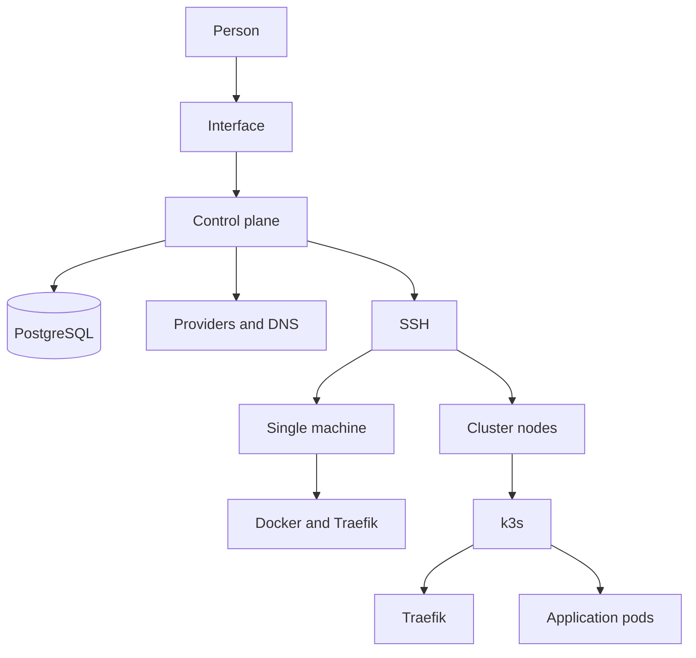
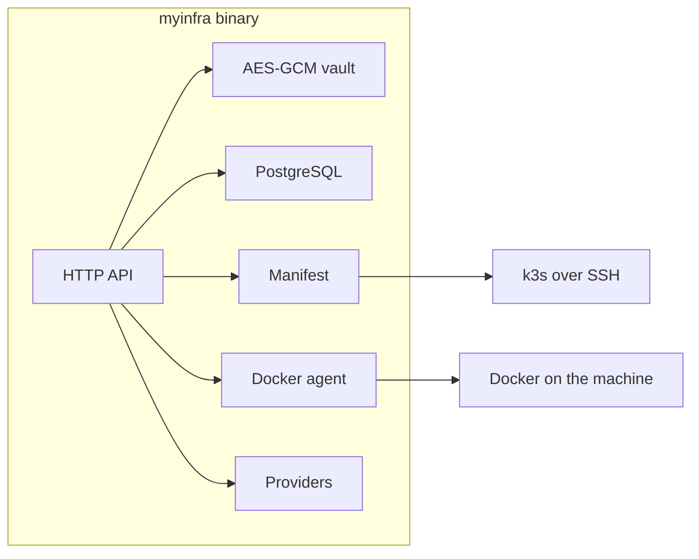

# MyInfra

MyInfra puts an application online without asking you to know Docker or Kubernetes.

You pick an application, a name, and a place to run it: a machine you already have, or a group of machines. MyInfra handles what you can see: the domain name, the certificate, the proxy, and keeping the application running. The screen talks about applications, machines, and domains. It does not talk about namespaces, ingresses, or ports.

The program is open source. The published image contains the same program. Anyone can read what they run.

Apache-2.0 license.

## Features

- **Overview.** The first screen after signing in. A map shows where the machines run; switch it to applications or pods, where each machine ring shows the state of its pods. Pick an application to light up the machines that run its pods. A panel lists what needs attention: failures, deployments and removals in progress, and applications whose pods all run on a single machine of a larger cluster. The hourly and monthly cost of the machines is shown at the top. ⌘K (Ctrl K) opens a search to jump to any application, machine, or page.
- **Catalogue.** Ready-made applications (site, database, tool). Pick one, or start from an image.
- **One machine or a cluster.** The same form. On a machine, the application is a Docker container. On a cluster, it becomes Kubernetes pods.
- **Pause.** The pods stop. The disk and the data stay. Visitors see a page that says the service is paused.
- **Domains and certificates.** MyInfra writes the DNS record when an account is linked, then obtains the certificate. Otherwise it shows the record to create.
- **Providers.** Buy and destroy a machine at Hetzner, Scaleway, OVH, DigitalOcean, Infomaniak, UpCloud, Akamai, Vultr, Exoscale, Gcore, Kamatera, and IONOS, with your own token. MyInfra does not resell compute.
- **A machine alone.** A machine bought from a provider, or one you already have with a command to paste. Its applications run in Docker, without a cluster.
- **Clusters.** Several linked machines, k3s, Traefik at the edge. Kubernetes talks between nodes over WireGuard only. The number of control planes is odd. A name points to every node, so losing one node keeps it up.
- **Redundancy.** When every pod of an app runs on one server, a button spreads it. An app without a disk runs several copies on different servers. An app that keeps its data in SQLite, such as Uptime Kuma, keeps one copy whose database is backed up continuously; if its server fails, it starts again on another one with its data. An app that can use PostgreSQL, such as Vikunja, moves to a database replicated on two servers and its files to the cluster storage, then runs several copies.
- **Templates.** A template describes an application, a machine, or a cluster, then deploys, exports, or deletes it.
- **SSH keys.** Generate an ed25519 key, or import a public key you already own. The chosen keys are allowed on the machines.
- **Secrets.** Declare keys, then check the applications allowed to receive them. Values never come back to the screen. On a cluster they become a Kubernetes Secret. On a machine, environment variables. An application variable with the same name wins.
- **Vault.** Provider, DNS, and Git tokens, encrypted. A list never returns the secret in clear text.
- **Logs, terminal, meters.** Pod status, a terminal on the machine or the pod, CPU and memory use.
- **Transfer.** Move MyInfra itself to a new machine or to a pod in the cluster, and follow the steps.
- **Copies.** Several MyInfra instances of the same owner exchange their database so nothing is left behind. A replica copy reads and syncs, and does not drive the machines: what it records is carried out by the main copy.
- **Online means online.** An application is shown online once its pods are ready and its address answers in HTTPS with a valid certificate.
- **Destruction.** Deleting an application, a machine, or a cluster asks you to type the name again. Destroying the cluster that runs MyInfra asks for a separate phrase.
- **One file.** In production, one executable contains the interface. Linux, macOS, and Windows.

## Architecture

The control plane is the only program you start. The interface is inside it. PostgreSQL keeps the state. The machines do not keep MyInfra's database: they run the applications.

On a single machine, MyInfra installs Docker and Traefik, then starts the container over SSH. On a cluster, MyInfra opens an SSH session to a node and applies a Kubernetes manifest. Traefik receives the traffic in both cases.

A service with a disk gets a volume local to the node, readable and writable by a single pod. Several copies of a service without a disk replace one another. Several copies of a service with a disk each get their own volume: that is not a shared folder, and it is not a database replica.

## Tools

| Role | Tool |
| --- | --- |
| Control plane | Go 1.24 |
| State | PostgreSQL, pgx driver |
| Interface | React 19, TypeScript, Vite, React Router |
| Style | Tailwind CSS v4, Geist, Lucide icons |
| Encryption | AES-GCM, one data key per secret, wrapped by the master key |
| SSH keys | ed25519 |
| Single machine | Docker Engine, Traefik |
| Cluster | k3s, Traefik, WireGuard between nodes |
| Certificates | Let's Encrypt, obtained by Traefik with the TLS-ALPN challenge once the DNS record answers |
| Cluster storage | Garage, an S3 object store on every node, three copies of each object on three servers |
| Backups and databases | Litestream for SQLite apps, CloudNativePG for PostgreSQL |
| Machines | Hetzner, Scaleway, OVH, DigitalOcean, Infomaniak, UpCloud, Akamai, Vultr, Exoscale, Gcore, Kamatera, and IONOS APIs |
| DNS | OVH, Cloudflare, Scaleway, Hetzner DNS |
| Image | One static binary, packed in a distroless image, published for linux/amd64 and linux/arm64 |
| Development | `npm run dev`, `./build` |

## Validated APIs

These integrations have been tried and confirmed. The others listed above are in the program, and have not been validated yet.

| Kind | Validated |
| --- | --- |
| Provider | Scaleway, Hetzner, DigitalOcean, Vultr, OVH, Exoscale |
| DNS | OVH |
| Git | None yet |

## How it works

**Startup.** With no variables, the binary creates `~/.myinfra`, writes a master key there, and starts the PostgreSQL it carries. The data stays when the process stops. Then you choose a password. MyInfra asks, in order, to install what is missing, then to add a first SSH key, a first provider and a first DNS account. Each step can be skipped. The terminal prints the address, for example `MyInfra : http://127.0.0.1:8080`. One session is enough: one account. `DATABASE_URL` keeps using an external database, and then `MYINFRA_MASTER_KEY` is still required. The key never goes into the database. `MYINFRA_NO_BROWSER=1` skips opening the browser. `MYINFRA_ACME_EMAIL` sets the Let's Encrypt account address, otherwise `certif@` followed by the zone. Windows arm64 has no embedded PostgreSQL and still needs `DATABASE_URL`.

On the pages that install a machine, a button installs Ansible into `~/.myinfra` when it is missing. The same pages offer OpenTofu for a Hetzner or Scaleway machine when `MYINFRA_TOFU_DIR` is set and `tofu` is missing. Neither install needs an administrator password.

**Create an application.** Source is the first choice. The catalogue fills in the image, the port, the disk, and the variables. You can cancel the selection and bring the list back. The control plane stores the application, then delivers it.

**Delivery on a cluster.** MyInfra renders a manifest: namespace, Deployment or StatefulSet, Service, Traefik routes, and a Secret for the variables. The manifest is sent as base64, then `kubectl apply`. An unreadable image, name, or variable is not applied, and the application already in place is not removed. The first SSH key of a node is remembered. A different key is refused.

**Delivery on a machine.** MyInfra runs the agent script on the machine over SSH, so the machine does not need to reach MyInfra. When it can, the agent also fetches the script by itself. The script creates the Docker network, the volume if the application keeps files, and the container. Traefik sends the domain name to that container.

**Port and folder.** For an application started from an image, MyInfra reads the port and the folders to keep that the image declares (`EXPOSE`, `VOLUME`). A declared folder gets a disk. The port can still be set by hand in the settings.

**Machines.** A cluster node first joins the WireGuard network, at an address that never changes, then installs k3s with that address. Removing a node moves its pods to the others before the machine is destroyed. A deployment cut off by a restart of MyInfra starts again where it stopped; a purchase cut off finds its machine again instead of buying a second one. Machines are tagged with their MyInfra server at Scaleway and Hetzner.

**Redundancy.** With at least three linked servers, MyInfra installs Garage on the cluster: every node holds part of the data, each object lives on three servers, and losing one changes nothing. A SQLite app gets Litestream next to it: its database is copied into Garage within a second. Its pod keeps no node disk; it restores the database when it starts, so Kubernetes can start it on any node, 30 seconds after its node stopped answering. An app moving to PostgreSQL is stopped, its data dumped and restored into a CloudNativePG cluster of two instances on two servers, then checked: the dump must exist and the tables that had rows must have rows after. Only then does it run several copies. If anything fails, it goes back to its disk. The old disk is never removed by MyInfra. Traefik, CoreDNS and the database operator also move within about a minute when their node fails, and Traefik gets its certificates back when it starts, so moving asks Let's Encrypt for nothing.

**Secrets.** Values are sealed before they are written. The API does not return them. At delivery time, MyInfra opens them and attaches them to the allowed application. If opening fails, the application is not redeployed without its secrets. An application variable whose name looks like a password, a key or a token is sealed the same way. The screen shows it masked; showing it is recorded in the history. A template file does not carry it.

**Copies.** Two MyInfra instances of the same owner exchange database rows. The newer version wins. Sessions do not travel. A copy marked as a replica deploys nothing and refuses the actions that act on machines right away.

**Transfer.** MyInfra can move itself. To a machine, cloud-init installs Docker and starts the program. To a cluster, two pods and Postgres are created, the data is copied, then the old copy stops. A page follows the steps.

**Build.** `npm run dev` starts a PostgreSQL cluster in `.pgdata` when `DATABASE_URL` points at this machine, then the API and the interface, as a replica when `MYINFRA_PEERS` names a main copy, so the two do not drive the machines at the same time. Without a peer it is the main copy: a replica alone would record requests that nothing carries out, and it refuses them. One terminal is enough. Stopping it leaves `.pgdata` in place. `./dev reset` asks for confirmation, saves `~/.myinfra/dev.sql`, then deletes `.pgdata`. `./dev restore` loads that file back. `./build` produces one executable, interface included, and packs PostgreSQL for that system; it needs Go, npm and `unzip`. `./build all` covers Linux, macOS, and Windows, amd64 and arm64. `go test ./...` runs the tests; those that need PostgreSQL use the local cluster on port 54329. `npm run e2e` in `web` runs the browser tests against a MyInfra started on `E2E_URL`. The CI runs both on each push.

**Release.** Pushing a tag such as `v1.4.0`, or running the *Publication* workflow from the Actions tab with a version, checks the code, builds the `./build` executables (PostgreSQL included) for Linux, macOS and Windows, amd64 and arm64, and the `linux/amd64` and `linux/arm64` image on `ghcr.io`, then publishes a GitHub release with the executables, a `compose.yaml` pinned to that image, and `SHA256SUMS`. A version with a suffix, such as `1.4.0-rc.1`, is published as a pre-release and leaves the `latest` image alone. `myinfra --version` prints the version an executable was built as.

## Transparency

This project was 100% vibe coded.

test it, brake it, fix it, use it

The code, the interface, and the image are public so anyone can check what they run, break it, fix it, and then use it. Your installation's secrets are not in the repository or in the image: they are encrypted in your database, or injected at startup.

## Page

The project page is [docs/index.html](docs/index.html). To publish it: in the GitHub repository, Pages, the `docs` folder on the main branch.
