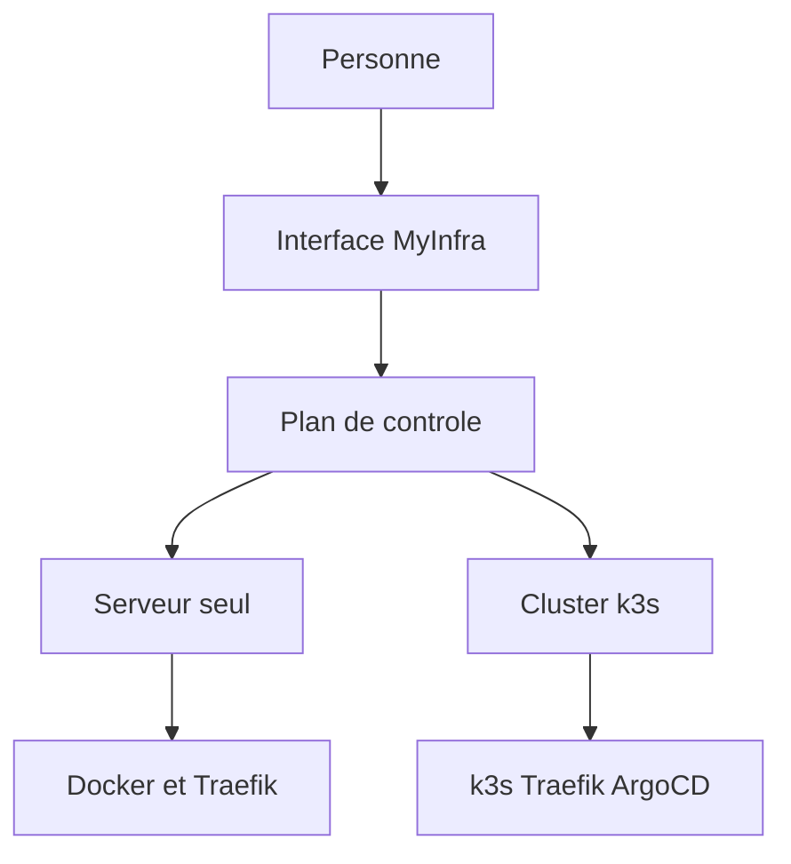

# Cahier des charges MyInfra

Premier jet. Licence cible : Apache-2.0.

MyInfra est une interface open source pour mettre une application en ligne sans connaître Docker ni Kubernetes. La personne relie un compte provider ou une machine à elle, indique un nom et un domaine, et choisit une source : un modèle, un dépôt Git ou une image. Le proxy, le certificat et l'enregistrement DNS restent hors de l'écran.

## 1. Personnes visées

Deux usages tiennent dans le même produit.

- Une personne non technique choisit un modèle, un domaine, et lance. L'achat du serveur est compris si un compte provider est lié.
- Une personne technique relie un dépôt Git, pose des variables, importe un cluster déjà construit (infrarongier), gère une clé SSH et lit le journal.

Le premier jet vise un seul utilisateur. Les objets portent déjà un propriétaire, pour ajouter une équipe plus tard sans déplacer les serveurs, les clés et les domaines.

## 2. Ce que l'écran montre

Six objets : compte provider, compte DNS, serveur, cluster, application, modèle.

Une application demande trois choses : un nom, un domaine et une source. Les variables et le nombre de copies sont repliés. Jamais à l'écran : ingress, namespace, port 443, classe d'ingress, type d'instance, cloud-init, Swarm, Kubernetes.

Un serveur se crée par un lieu et une taille (petit, moyen, grand), ou par une commande à coller sur une machine déjà à soi. L'heure ou le mois est une phrase du provider, pas un réglage. Hetzner et Scaleway facturent à l'heure, souvent avec un plafond au mois. Un VPS OVH est au mois. Le Public Cloud OVH est à l'heure. MyInfra ne revend pas le calcul.

Cinq écrans : accueil, nouveau déploiement, application, serveurs, réglages. Le coffre est dans les réglages : clés SSH, jetons provider, jetons DNS. Il n'est pas un septième objet de l'accueil.

## 3. Destinations

Deux destinations existent, avec le même formulaire.

- **Serveur seul.** Une application tourne dans Docker sur cette machine. Pas de Kubernetes, pas de WireGuard, pas d'Argo CD.
- **Cluster.** Plusieurs machines forment un cluster k3s. L'application est placée par le cluster. Argo CD livre depuis Git, sans montrer Argo CD.

Un serveur peut rester seul toute sa vie. Rejoindre un cluster est une action séparée, refusée tant que des applications locales y tournent encore.

### Serveur seul

L'agent installe Docker Engine et Traefik. L'application est un conteneur qui écoute en HTTP sur le port fixé par la plateforme. Traefik tient les ports 80 et 443, termine le TLS, et envoie vers le conteneur. Une nouvelle version démarre à côté de l'ancienne quand l'application ne garde pas de fichiers, puis le trafic bascule. Si elle garde un dossier, l'ancienne s'arrête avant la nouvelle.

### Cluster

k3s, une architecture CPU par cluster, x86 ou ARM. Traefik est l'entrée unique. Argo CD applique ce que le plan de contrôle a décrit. Les rôles utiles sont edge, manager et worker. Le nombre de managers est impair. La donnée d'une base reste sur un disque d'un nœud, avec une sauvegarde chiffrée vers un bucket à vous.

### Réseau

Un serveur seul n'a pas de maillage. Dès qu'un cluster a plusieurs machines, WireGuard les relie. Une machine à la maison sans IPv4 fixe ouvre un tunnel sortant vers le nœud edge. Un Raspberry Pi rejoint un cluster ARM, en worker. Le edge et les managers restent sur des machines stables.

### DNS et TLS

Le comportement est le même sur un serveur seul et sur un cluster.

- Compte DNS lié (OVH d'abord, puis Cloudflare, Scaleway, Hetzner DNS) : MyInfra écrit l'enregistrement et demande le certificat en DNS-01.
- Zone déléguée : PowerDNS répond, comme sur infrarongier.
- Sinon : MyInfra affiche le CNAME ou l'enregistrement A, vérifie la réponse publique, puis termine en HTTP-01.

Le nom n'est routé qu'une fois le certificat en place. Un nom par défaut existe dès la création. Le domaine de la personne pointe dessus en CNAME quand la racine du domaine ne peut pas porter de CNAME.

## 4. Exigences fonctionnelles

- Conserver les secrets dans un coffre : clés SSH, jetons provider, jetons DNS. Créer une clé SSH ed25519 dans l'interface, ou importer une clé publique déjà à soi. Au moment d'acheter ou de préparer un serveur, choisir les clés à autoriser pour root.
- Relier Hetzner, Scaleway et OVH par un jeton du coffre. Créer et détruire la machine via le SDK Go officiel du provider. Passer les clés publiques choisies au provider. Préparer la machine par cloud-init.
- Lier une machine quelconque par une commande. L'agent appelle le plan de contrôle, y compris derrière un NAT. Le CGNAT est couvert si un edge public existe pour le tunnel.
- Déployer une application sur un serveur seul ou sur un cluster, avec le même formulaire.
- Importer infrarongier par son kubeconfig : lire Traefik et Argo CD, ne pas installer k3s, ne pas remplacer WireGuard `10.10.0.0/24`, ne pas écraser les enregistrements `ifportup` de PowerDNS.
- Lier un dépôt Git. Sur un cluster, Argo CD synchronise. Sur un serveur seul, l'agent construit ou tire l'image et remplace le conteneur.
- Modèles de serveur, de cluster et d'application. Un modèle d'application sur serveur seul achète une machine, la prépare et publie. Un modèle de cluster achète les machines, forme k3s, puis publie.
- Journaux de l'application et état du domaine : DNS, certificat, route.

## 5. Socle technique

- Plan de contrôle en Go, état dans PostgreSQL, travaux dans une file (River). Un binaire pour l'API, un binaire pour l'agent.
- Interface en TypeScript et React, détaillée plus bas. Le statut d'un déploiement et les journaux arrivent en flux.
- Coffre de secrets, détaillé plus bas. Les jetons et les clés privées ne vont pas dans Git.
- Proxy : Traefik dans les deux destinations, pour un seul comportement de domaine.
- TLS : cert-manager sur un cluster. Le plan de contrôle parle à Let's Encrypt pour un serveur seul et pousse le certificat à Traefik.
- Clusters neufs : k3s. Kubespray reste le runtime importé d'infrarongier, pas le chemin d'un clic.
- Licence Apache-2.0.

Hors du premier produit : revente de serveurs, catalogue de centaines d'applications, IPv6, Windows, édition hébergée multi-équipes, volume répliqué entre nœuds.

### Providers

Les providers Terraform et OpenTofu existent et sont le bon inventaire de ce que l'API permet : `hetznercloud/hcloud`, `scaleway/scaleway`, `ovh/ovh`. Ils créent la machine, la clé SSH, le pare-feu et passent le cloud-init. Ils ne déploient pas l'application, le proxy, le certificat, le DNS du domaine, k3s ni l'agent.

On ne réécrit pas les clients HTTP. Chaque provider Terraform n'est qu'une enveloppe d'un SDK Go déjà publié.

- Hetzner : `hcloud-go`
- Scaleway : `scaleway-sdk-go`
- OVH : `go-ovh`, client REST signé, donc plus de travail de mapping que les deux autres

On n'appelle pas `terraform apply` au moment du clic. Les ressources n'ont pas le même schéma (`hcloud_server`, `scaleway_instance_server`, `ovh_cloud_project_instance`, `ovh_vps`). L'état Terraform, son verrou, les secrets qu'il copie et le temps d'un apply ne conviennent pas à l'écran. MyInfra garde l'état dans PostgreSQL.

Ce qu'on écrit, par provider : un adaptateur avec trois opérations (lister les tailles, créer, détruire) et une correspondance petit / moyen / grand vers le type d'instance. Le cloud-init, commun, installe l'agent. Dès que la machine répond, Terraform n'a plus de rôle.

Le DNS suit la même règle. OVH, Cloudflare, Scaleway et Hetzner DNS ont un SDK ou une API. L'adaptateur crée l'enregistrement du domaine. external-dns reste une option pour un cluster importé, pas le moteur du clic.

Plus tard, un export OpenTofu permet à une personne technique de reprendre une machine hors de MyInfra. Ce n'est pas le chemin de création.

### Coffre

Le coffre garde trois sortes de secrets, chiffrés dans PostgreSQL : clés SSH, jetons provider, jetons DNS. La clé maîtresse vient de l'environnement du plan de contrôle, pas de la base. Chaque secret a sa propre clé de données, enveloppée par la clé maîtresse (AES-GCM). Une liste ne renvoie jamais le secret en clair. Un jeton s'affiche par ses quatre derniers caractères. Une clé SSH s'affiche par son empreinte et sa clé publique.

Une clé SSH se crée de deux façons.

- **Générer.** Le plan de contrôle crée une paire ed25519. La clé privée reste dans le coffre. La personne peut la télécharger pour s'en servir depuis son poste. La clé publique est celle qu'on autorise sur les serveurs.
- **Importer.** La personne colle une clé publique qu'elle possède déjà. MyInfra ne reçoit pas la clé privée et ne peut pas la télécharger.

À la création d'un serveur, l'écran propose les clés du coffre, et le bouton pour en générer une si le coffre est vide. Les clés publiques choisies partent dans `authorized_keys` via le provider et le cloud-init. Retirer une clé du coffre la retire ensuite des serveurs qui l'avaient, par l'agent. L'agent parle au plan de contrôle en sortant : la clé SSH sert à la personne, pas au pilotage quotidien.

Un jeton provider ou DNS se colle une fois, est vérifié par un appel léger à l'API, puis n'est plus relu. Le remplacer est la seule façon de le changer. Le supprimer coupe les achats et les écritures DNS qui s'en servaient, sans éteindre les machines déjà créées.

## 6. Interface graphique

L'interface est claire, large, et presque sans couleur. Une action principale par écran. La couleur sert au bouton de cette action et à l'état d'un domaine ou d'un déploiement. Le reste est du texte sur un fond pierre.

### Stack

- React, TypeScript, Vite.
- Tailwind CSS v4, pour tenir une seule échelle d'espacement et les tokens.
- shadcn/ui : les composants sont copiés dans le dépôt, au-dessus de Radix. On garde le dialogue, le menu, le champ et le toast. On retire le thème par défaut.
- lucide-react, 16 px, trait 1,5, couleur du texte. Une icône seulement quand elle distingue une action : copier, révéler, supprimer.
- Geist Sans pour le texte. Geist Mono seulement pour une commande à coller, une empreinte ou un nom de domaine.
- Les couleurs sont des variables CSS. Le premier usage est clair. Le thème sombre reprendra les mêmes rôles, plus tard, sans deuxième palette.

MUI, Ant Design, Chakra et Mantine sont écartés : leur peau est déjà un produit. Radix Themes aussi. Pas de bibliothèque d'animation ni de graphiques au premier usage.

### Palette

Pierre, encre, et trois teintes d'état. Pas de couleur de marque.

- Fond de page `#FAFAF9`. Surface `#FFFFFF`. Filet `#E7E5E4`.
- Texte `#1C1917`. Texte secondaire `#57534E`. Mention discrète `#78716C`, jamais pour une phrase importante.
- Bouton principal : fond `#1C1917`, texte `#FAFAF9`. Les autres actions sont du texte, sans fond.
- Focus : filet `#A8A29E`. Pas d'anneau bleu.
- États, sur le statut seulement : succès `#3F6212`, attention `#92400E`, échec `#991B1B`. Le fond d'un statut reste `#F5F5F4`.

Rayon 6 px. Espacements 8, 16, 24 et 48. Titre de page 24 px, corps 15 px, interligne 1,5. Un formulaire reste dans une colonne d'environ 720 px. Pas de dégradé, pas d'ombre portée, pas d'illustration.

Le premier écran construit, la liaison d'un serveur seul, utilise déjà ces tokens.

## 7. Plan de construction

1. Modèle de données et API : utilisateur, coffre, serveur, application, domaine. L'application pointe vers un serveur ou vers un cluster. Le coffre génère une clé ed25519 et conserve un jeton sans le réafficher.
2. Commande de liaison, Docker et Traefik sur un serveur seul, déploiement d'une image publique, domaine affiché à copier.
3. Compte DNS OVH : écriture de l'enregistrement et certificat sans copie manuelle.
4. Dépôt Git sur un serveur seul.
5. Compte Hetzner : le jeton est dans le coffre, une clé SSH générée ou importée est autorisée sur la machine, cloud-init installe l'agent, modèle « une application, un serveur ».
6. Import d'infrarongier et première application via Argo CD.
7. Cluster k3s créé par MyInfra, WireGuard, modèle « cluster ».
8. Scaleway, OVH, trois managers, drain, edge déplaçable.

L'étape 2 est le premier usage réel. L'étape 6 réutilise infrarongier. Les étapes 7 et 8 sont la haute disponibilité.

## 8. Critères d'acceptation du premier usage

Sur un serveur seul, sans cluster : coller la commande, choisir une image, donner un domaine, obtenir une URL HTTPS dont l'enregistrement a été écrit chez OVH. Aucun écran ne mentionne Docker, Traefik ou un port.
